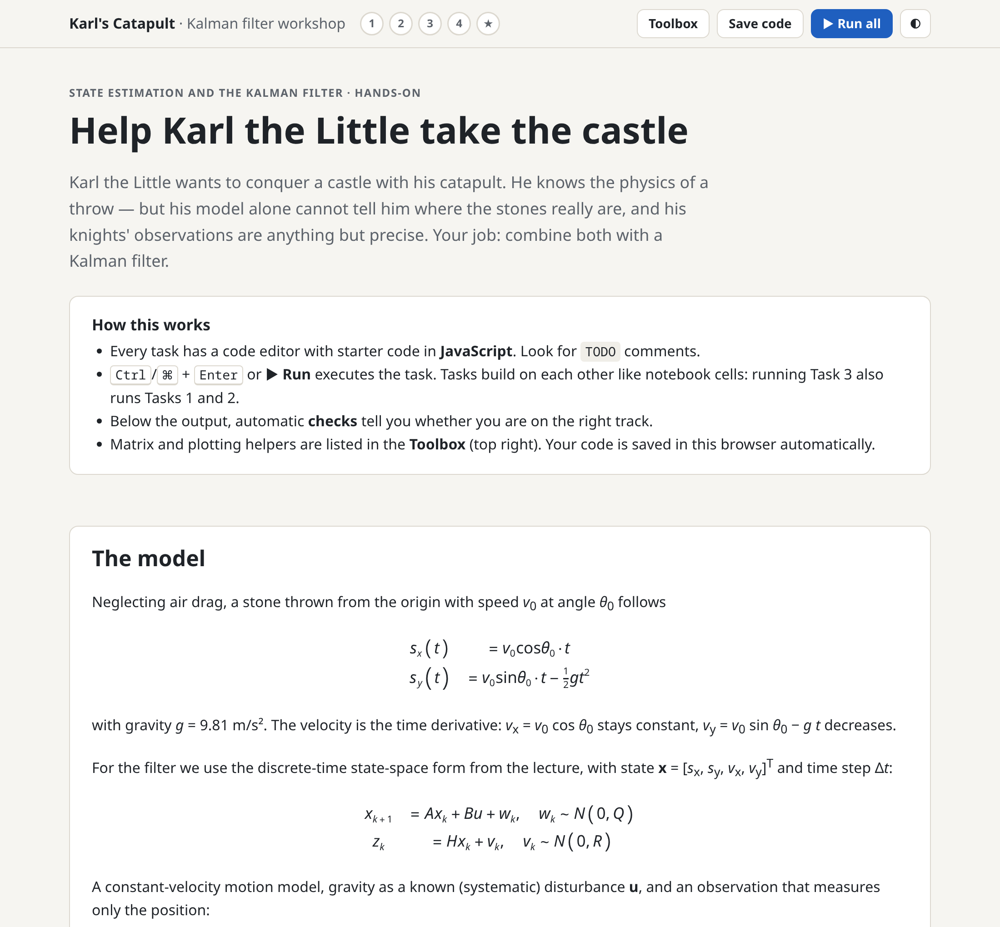
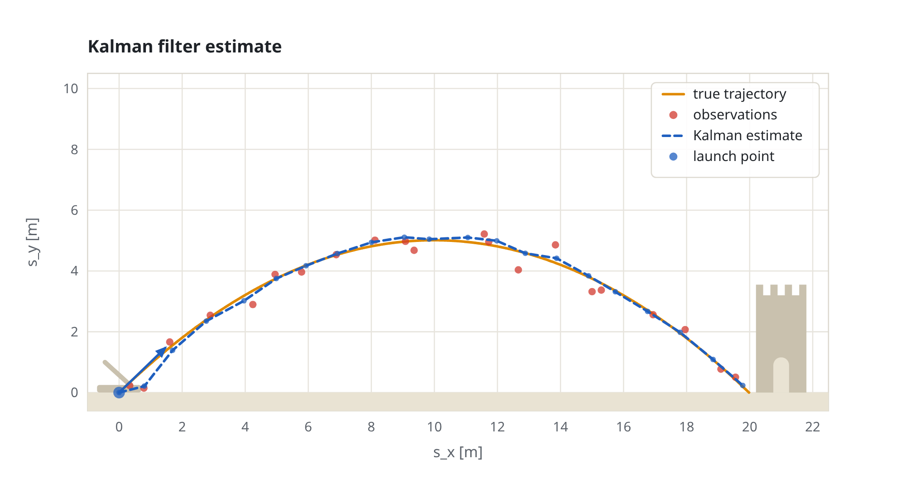
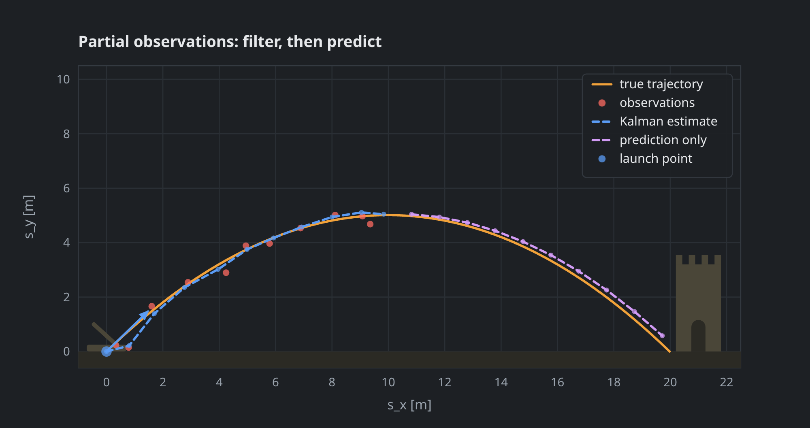
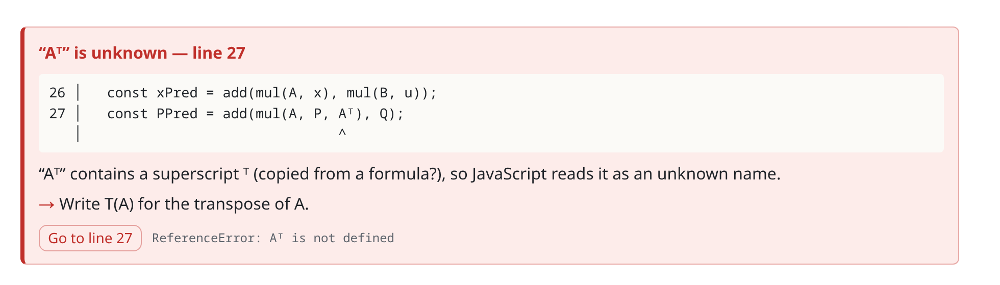

<div align="center">

# Karl's Catapult

A hands-on introduction to state estimation and the Kalman filter. Help Karl the Little take the castle by tracking his catapult stones, right in your browser.

<p>
  
  
  
  
</p>

<p>
  <a href="https://bassamlab.github.io/Karls-Catapult/"><strong>▶ Open the workshop</strong></a>
</p>

<p>
  <a href="#features-at-a-glance">Features</a> •
  <a href="#the-hands-on-example">The example</a> •
  <a href="#the-tasks">Tasks</a> •
  <a href="#getting-started">Getting started</a> •
  <a href="#for-instructors">For instructors</a> •
  <a href="#how-it-works">How it works</a> •
  <a href="#background">Background</a> •
  <a href="#license">License</a>
</p>

</div>

<p align="center">
  
</p>

A Kalman filter is easy to write down and hard to *feel*. This workshop makes it tangible: you simulate a catapult throw, generate noisy observations, implement the prediction and update steps yourself and watch how the estimate locks onto the true trajectory, including the velocity that is never measured and the part of the flight hidden behind the castle wall.

Everything runs in the browser. Participants write a few lines of JavaScript per task, press **Run** and immediately see plots, numbers and automatic checks. There is nothing to install, no server and no account. The page also works offline from a USB stick.

## Features at a glance

| Area | What you get |
| --- | --- |
| [Guided tasks](#the-tasks) | Four tasks and a bonus, each with a short story, a to-do list, hints and starter code with `TODO` markers |
| [Live code editor](#how-it-works) | Syntax highlighting, line numbers, indentation, comment toggle, <kbd>Ctrl</kbd>/<kbd>⌘</kbd>+<kbd>Enter</kbd> to run |
| [Notebook-like execution](#how-it-works) | Tasks share one scope like notebook cells: running Task 3 also runs Tasks 1 and 2 |
| [Automatic checks](#the-tasks) | Below each result: is the angle optimal, are the observations noisy, does the filter beat the raw measurements? |
| [Helpful error messages](#helpful-error-messages) | Plain-language explanations with the exact line, e.g. unclosed brackets, symbols copied from formulas, Python habits, typos |
| [Toolbox](#toolbox) | A small numpy-like library: `mul`, `add`, `T`, `inv`, `eye`, `diag`, `col`, `linspace`, `sampleAt`, `randn`, … |
| [Plots](#the-tasks) | The catapult scene with castle, line and bar charts; light and dark mode |
| [Sample solutions](#for-instructors) | Optional **Show solution** button per task, removable with one file |
| [Persistence](#getting-started) | Code is saved in the browser automatically; **Save code** downloads everything as one file |

## The hands-on example

Karl the Little wants to conquer a castle with his catapult. He knows the physics of a throw, but his model alone cannot tell him where the stones really are, and the observations of his knights (who enjoy their goblets more than their duties) are anything but precise. The participants' job is to combine both with a Kalman filter.

### The model

Neglecting air drag, a stone thrown from the origin with speed $`v_0`$ at angle $`\theta_0`$ follows

```math
s_x(t) = v_0 \cos\theta_0 \, t, \qquad
s_y(t) = v_0 \sin\theta_0 \, t - \tfrac{1}{2} g t^2 .
```

For the filter, the throw is written as a discrete-time linear system with the state $`\mathbf{x} = [s_x, s_y, v_x, v_y]^T`$, a constant-velocity motion model, gravity as a known (systematic) disturbance $`\mathbf{u}`$, and an observation $`\mathbf{z}`$ that measures only the position:

```math
\mathbf{x}_{k+1} = \mathbf{A}\mathbf{x}_k + \mathbf{B}\mathbf{u} + \mathbf{w}_k,\quad \mathbf{w}_k \sim \mathcal{N}(0, \mathbf{Q})
\qquad
\mathbf{z}_k = \mathbf{H}\mathbf{x}_k + \mathbf{v}_k,\quad \mathbf{v}_k \sim \mathcal{N}(0, \mathbf{R})
```

```math
\mathbf{A} = \begin{bmatrix} 1 & 0 & \Delta t & 0 \\ 0 & 1 & 0 & \Delta t \\ 0 & 0 & 1 & 0 \\ 0 & 0 & 0 & 1 \end{bmatrix},\quad
\mathbf{B}\mathbf{u} = \begin{bmatrix} 0 \\ 0 \\ 0 \\ -g\,\Delta t \end{bmatrix},\quad
\mathbf{H} = \begin{bmatrix} 1 & 0 & 0 & 0 \\ 0 & 1 & 0 & 0 \end{bmatrix}
```

### The Kalman filter

Every time step combines *what should have happened* (prediction) with *what we saw happen* (update):

| Step | Equations |
| --- | --- |
| Predict | $`\hat{\mathbf{x}}_k^- = \mathbf{A}\hat{\mathbf{x}}_{k-1} + \mathbf{B}\mathbf{u}`$ <br> $`\mathbf{P}_k^- = \mathbf{A}\mathbf{P}_{k-1}\mathbf{A}^T + \mathbf{Q}`$ |
| Update | $`\mathbf{K}_k = \mathbf{P}_k^-\mathbf{H}^T(\mathbf{H}\mathbf{P}_k^-\mathbf{H}^T + \mathbf{R})^{-1}`$ <br> $`\hat{\mathbf{x}}_k = \hat{\mathbf{x}}_k^- + \mathbf{K}_k(\mathbf{z}_k - \mathbf{H}\hat{\mathbf{x}}_k^-)`$ <br> $`\mathbf{P}_k = (\mathbf{I} - \mathbf{K}_k\mathbf{H})\mathbf{P}_k^-`$ |

In the workshop these lines translate almost one to one into code, for example `P = add(mul(A, P, T(A)), Q)`.

<p align="center">
  
</p>

## The tasks

| Task | Story | What participants learn |
| --- | --- | --- |
| **1 · The true trajectory** | How *should* the catapult behave? | Implement the motion model, find the optimal launch angle (45°) and the time of landing |
| **2 · The knights' observations** | The knights measure at 10 Hz, but with shaky hands | Simulate noisy sensors, quantify the measurement error |
| **3 · Predict and update** | Karl combines model and observations | Implement the Kalman filter, see why open-loop prediction drifts, tune **Q** and **R** until the filter beats the raw observations |
| **4 · Estimating what nobody measured** | The knights only report positions | Evaluate the velocity estimate, a quantity that is never observed |
| **★ Behind the castle wall** | The wall hides the second half of the flight | Filter while observations are available, then predict; watch the uncertainty **P** grow and estimate the landing point |

The bonus task also suggests further experiments: a wrong initial state, strong winds high up, and a model that forgets gravity.

<p align="center">
  
</p>

With the sample solution the numbers come out as follows: optimal angle ≈ 45°, landing after 2.02 s at 19.98 m; mean observation error 0.384 m versus 0.150 m for the Kalman filter; mean velocity error 0.39 m/s.

## Getting started

### Option 1: Online

Open **<https://bassamlab.github.io/Karls-Catapult/>**. That's all.

### Option 2: Locally

```bash
git clone https://github.com/bassamlab/Karls-Catapult.git
```

Open `index.html` in Chrome, Firefox, Safari or Edge. No build step, no server and no internet connection are needed, so the folder can also be shared as a zip file or on a USB stick for workshops with unreliable Wi-Fi.

Any static web server works as well, for example:

```bash
cd Karls-Catapult
python3 -m http.server 8000   # then open http://localhost:8000
```

### Working with the page

- Every task has an editor with starter code. Look for the `TODO` comments.
- <kbd>Ctrl</kbd>/<kbd>⌘</kbd>+<kbd>Enter</kbd> or **▶ Run** executes the task and all tasks before it. **▶ Run all** runs everything.
- The checks below each output show what is already correct.
- The **Toolbox** button lists all helper functions and keyboard shortcuts.
- Code is stored in the browser's local storage and survives reloads. **Reset** restores the starter code, **Save code** downloads your code.

## For instructors

<details>
<summary><strong>Hide or show the sample solutions</strong></summary>

The **Show solution** buttons appear only if `solutions/solutions.js` is present. Delete that file (or the `<script>` line that loads it at the end of `index.html`) before handing the folder to participants. Both **Reset** and **Show solution** can be undone with <kbd>Ctrl</kbd>/<kbd>⌘</kbd>+<kbd>Z</kbd>.

</details>

<details>
<summary><strong>Change texts, starter code or checks</strong></summary>

| What | Where |
| --- | --- |
| Story, task descriptions, hints | the `<section class="task">` blocks in `index.html` |
| Starter code | `<script type="text/plain" class="starter">` inside each task section |
| Sample solutions | `solutions/solutions.js` |
| Automatic checks | `CHECKS` in `js/app.js`, selected per task with the `data-check` attribute |

Participants keep their saved code after the page changes. They get new starter code with **Reset** or in a fresh browser.

</details>

## Toolbox

Participants write plain JavaScript. A small toolbox replaces the numpy functions of the original notebook. Matrices are arrays of rows, column vectors are created with `col([…])`, points are `[x, y]`.

<details>
<summary><strong>All functions</strong></summary>

| Function | Purpose |
| --- | --- |
| `eye(n)`, `zeros(r, c)`, `ones(r, c)`, `diag([…])`, `col([…])` | Create matrices and column vectors |
| `mul(A, B, …)`, `add(A, B, …)`, `sub(A, B)`, `scale(A, k)` | Matrix product, sum, difference, scaling |
| `T(A)`, `inv(A)` | Transpose and inverse |
| `range(a, b, step)`, `linspace(a, b, n)` | Time vectors, like `numpy.arange` and `numpy.linspace` |
| `interp(x, xp, fp)`, `sampleAt(tq, t, points)` | Linear interpolation of values and trajectories |
| `dist(a, b)`, `norm(v)`, `mean`, `sum`, `max`, `min`, `argmax` | Errors and statistics |
| `deg2rad`, `rad2deg`, `seed(n)`, `randn(mu, sigma)`, `rand()` | Angles and reproducible random numbers |
| `print(…)` | Print numbers, arrays and matrices |
| `plotScene({ p0, v0, truth, observations, estimate, prediction })` | The catapult scene |
| `plotLines(title, series, options)`, `plotBars(title, series, options)` | Line and bar charts |

</details>

## How it works

The page is plain HTML, CSS and JavaScript without any framework or external resources.

- **Execution.** On **Run**, the code of all tasks up to the current one is joined into a single script and executed, so variables flow from task to task like in a notebook. Before that, every task is compiled on its own, so a syntax error is reported in the task that contains it.
- **Checks.** After each task the runner reads the task's result variables (for example `theta`, `meanErrObs`, `meanErrEst`) and evaluates simple plausibility checks.
- **Plots.** Charts are drawn as SVG and follow the light or dark color scheme.

### Helpful error messages

Most participants are not JavaScript developers, and many come from Python. Raw browser messages such as `Unexpected token ';'` or `Unexpected end of input` do not help them. The app therefore analyses each error and explains it in plain language, with the exact line marked and a concrete fix:

<p align="center">
  
</p>

It recognises, among others: unclosed or mismatched brackets and strings, symbols copied from formulas (`·`, `×`, `−`, `²`, `ᵀ`, `⁻¹`), Python habits (`for k in range(…):`, `def`, `#` comments, `np.`, `len()`, `True`, `A.T`), typos with "did you mean …?" suggestions, variables used outside their block or before the task that declares them, matrix dimension mismatches and indices past the end of an array. Error locations are tested in Chrome and Firefox, both online and with the page opened directly from a file.

## Repository layout

```text
Karls-Catapult/
├── index.html               # The workshop: story, model, tasks, starter code, toolbox reference
├── css/style.css            # Layout, light and dark theme
├── js/
│   ├── linalg.js            # Toolbox: matrices, arrays, interpolation, random numbers
│   ├── plot.js              # SVG charts and the catapult scene
│   ├── editor.js            # Lightweight code editor
│   ├── errors.js            # Plain-language error explanations
│   └── app.js               # Runner, checks, persistence, page wiring
├── solutions/solutions.js   # Sample solutions (optional)
├── documentation/images/    # Screenshots for this README
├── legacy/                  # The original 2023 Jupyter notebooks
└── License.txt
```

## Background

Karl's Catapult was created by Simon Schäfer at the Chair of Embedded Software (Informatik 11), RWTH Aachen University, within subproject B03 of the Collaborative Research Center [SFB/TRR 339 "Digital Twin Road"](https://www.sfbtrr339.de/en), funded by the German Research Foundation (DFG).

It was first held as a Jupyter notebook workshop at the [International Summer School of SFB/TRR 339](https://www.sfbtrr339.de/en/events/international-summer-school-of-sfb-trr-339) (August 21–25, 2023, Federal Highway Research Institute BASt, Bergisch Gladbach). It is now used in the lecture series of the [integrated research training group (subproject MGK)](https://www.sfbtrr339.de/en/project/project-area-c/mgk) of SFB/TRR 339, for which it was rewritten as this browser-based version. The original notebooks are kept in [`legacy/`](legacy).

## License

Copyright © 2023 Lehrstuhl Informatik 11 – Embedded Software, RWTH Aachen University. See [License.txt](License.txt) for the terms of use.
